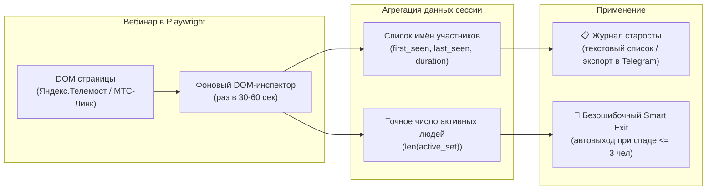
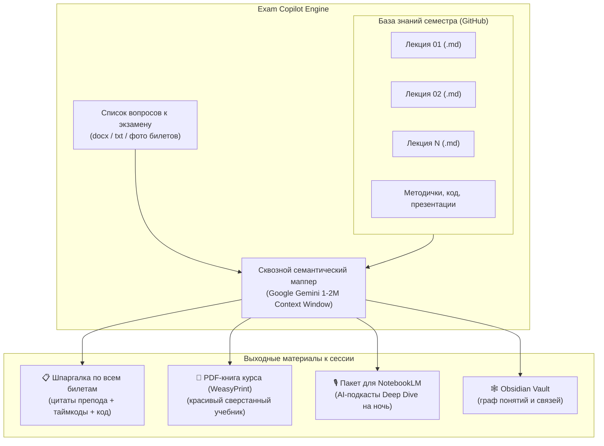

# 💡 Точки роста и дорожная карта развития: StudentAssistant

В данном документе зафиксированы актуальные стратегические инициативы, архитектурные улучшения и продуктовые идеи по развитию проекта.

---

## 📌 Содержание
- [1. Модуль старосты: Автоматический журнал посещаемости и надёжный трекинг участников (Telemost / MTS Link)](#1-модуль-старосты-автоматический-журнал-посещаемости-и-надёжный-трекинг-участников-telemost--mts-link)
  - [1.1. Сбор имён участников и журнал посещаемости для старосты (`/attendance`)](#11-сбор-имён-участников-и-журнал-посещаемости-для-старосты-attendance)
  - [1.2. Точный подсчёт присутствующих и безотказный Smart Exit (автовыход)](#12-точный-подсчёт-присутствующих-и-безотказный-smart-exit-автовыход)
- [2. Стратегический уровень: Экзаменационный копайлот к сессии (Этап 4 Roadmap)](#2-стратегический-уровень-экзаменационный-копайлот-к-сессии-этап-4-roadmap)
  - [2.1. Генератор ответов на экзаменационные билеты (`/exam_prep`)](#21-генератор-ответов-на-экзаменационные-билеты-exam_prep)
  - [2.2. Сборка единого типографского PDF-учебника курса (`/build_book`)](#22-сборка-единого-типографского-pdf-учебника-курса-build_book)
  - [2.3. Пакетный экспорт в Google NotebookLM](#23-пакетный-экспорт-в-google-notebooklm)
  - [2.4. Синхронизация с Obsidian Knowledge Graph](#24-синхронизация-с-obsidian-knowledge-graph)
- [3. Повседневный студенческий UX](#3-повседневный-студенческий-ux)
  - [3.1. Мгновенный просмотр через Telegraph API (Instant View)](#31-мгновенный-просмотр-через-telegraph-api-instant-view)
- [4. Инженерные доработки надежности и VPS-оптимизации](#4-инженерные-доработки-надежности-и-vps-оптимизации)
  - [4.1. Ожидание статуса ACTIVE при загрузке аудио в Google Files API](#41-ожидание-статуса-active-при-загрузке-аудио-в-google-files-api)
  - [4.2. AI-слой: работа с графикой из больших PDF и доп. картинками](#42-ai-слой-работа-с-графикой-из-больших-pdf-и-доп-картинками)
  - [4.3. Настройки обрезания (кропа) интерфейса для Яндекс.Телемоста и МТС-Линка](#43-настройки-обрезания-кропа-интерфейса-для-яндекс-телемоста-и-мтс-линка)
- [5. Матрица приоритетов реализации (Impact vs Effort)](#5-матрица-приоритетов-реализации-impact-vs-effort)

---

## 1. Модуль старосты: Автоматический журнал посещаемости и надёжный трекинг участников (Telemost / MTS Link)



### 1.1. Безошибочный парсинг участников из DOM и интервальный трекинг (Этап 1 — ✅ Реализовано)
- **Запрос старосты**:
  - На каждой онлайн-паре старосте группы или потока требуется фиксировать присутствующих для отчёта преподавателю или деканату.
- **Проблема ложных «отметок» (перезаходы)**:
  - Студент может зайти на 5 минут в начале пары, вылететь, зайти в середине на 5 минут и подключиться в конце на 5 минут. Если фиксировать только `first_seen` и `last_seen`, выйдет, что он «был всю пару» (85 минут), хотя реально провёл на занятии всего 15 минут.
- **Решение — Интервальный трекинг присутствия (`recorder/attendance.py`)**:
  - В фоновом цикле мониторинга пары бот периодически (каждые 30 секунд) опрашивает DOM-контейнер списка участников (`participantsSidebar` в Яндекс.Телемосте и `StreamPeople` / `UserRowName__name` в МТС-Линке).
  - Для каждого участника сохраняется список сессий подключения:
    `intervals: [ [09:05, 09:10], [09:45, 09:50], [10:25, 10:30] ]`.
  - Сглаживание сетевых скачков (debounce 90 сек): если человек вылетел и перезашёл через 30–60 секунд, интервал не рвётся, а склеивается.
  - Точный расчёт: реальное время присутствия (сумма активных минут, например $5+5+5 = 15$ мин), число переподключений и процент от длительности пары.
  - **Статус внедрения**: ✅ **Реализован Шаг 2**: надёжный парсинг участников из DOM Telemost/MTS Link, модуль `ParticipantTracker` с 90s debounce, сбор интервалов в `metadata.json` (`"attendance"`) и вывод количества в Telegram карточку пары. Следующим этапом будет пользовательский UI для старосты (`/attendance`, экспорт таблицы).

### 1.2. Логика завершения пары: Smart Exit 2.0 (4 универсальных правила — ✅ Реализовано)
- **Проблемы прежней логики**:
  1. *Лабораторные и практики с перерывом*: препод даёт задание в первые 20 минут, группа расходится делать, на звонке остаётся 1–2 человека. Прежний бот выходил по спаду людей на 65-й минуте и пропускал всю защиту работ в конце!
  2. *Затянувшиеся лекции*: если препод ведёт занятие 2 часа (последняя пара или перенос), прежний таймер на 95 минут принудительно обрывал запись.
- **Согласованная архитектура Smart Exit 2.0 (4 правила)**:
  1. **Лимит времени или следующая пара**: если пара длится $\ge 180$ минут (3 часа, защита VPS от переполнения) ИЛИ наступает время за 3–5 минут до начала следующей пары по расписанию $\to$ **СТОП**, пара завершена (гарантирует корректное переключение на новую пару).
  2. **Официальное закрытие комнаты**: если Телемост или МТС-Линк выкинул модальное окно завершения («Организатор завершил встречу для всех») или произошёл редирект со страницы звонка $\to$ **СТОП**, пара завершена.
  3. **Тройное условие завершения**: если пара идёт $> 95.3$ мин **И** участников $\le 3$ (наш бот + максимум 1-2 забывших закрыть вкладку студента) **И** фиксируется тишина 3 минуты $\to$ **СТОП**, пара завершена.
     - *Как определяется тишина*: после 95.3 минут бот каждую минуту «щупает пульс» аудиопотока — проверяет 10-секундный отрезок звука. Если 3 замера подряд показывают тишину ($< -38$ dB) — тишина подтверждена. Никаких нестабильных DOM-иконок микрофонов, только честный замер звука.
  4. **Все остальные случаи**: $\to$ **ПАРА ПРОДОЛЖАЕТСЯ** (на лабах бот спокойно дожидается конца пары по звонку, а длинные лекции пишутся до реального ухода препода).

---

## 2. Стратегический уровень: Экзаменационный копайлот к сессии (Этап 4 Roadmap)



### 2.1. Генератор ответов на экзаменационные билеты (`/exam_prep`)
- **Проблема**: Перед зачетом или экзаменом студенты тратят недели на ручной поиск ответов на 30–60 вопросов в разрозненных источниках.
- **Решение**:
  - Студент отправляет боту документ со списком вопросов (`voprosy_k_ekzamenu.docx` или список текстом).
  - За счет контекстного окна Gemini Flash (1–2 млн токенов) все конспекты семестра, методички и код подаются в модель единым батчем.
  - Модель сопоставляет каждый экзаменационный вопрос с материалами реальных лекций и формирует документ:
    - Четкий ответ на вопрос в академическом стиле.
    - Авторские акценты и подводные камни, упомянутые преподавателем (*«Препод подчеркивал, что за эту ошибку сразу снижает балл»*).
    - Точные ссылки на разделы конспектов и таймкоды.

### 2.2. Сборка единого типографского PDF-учебника курса (`/build_book`)
- **Проблема**: Читать отдельные Markdown-файлы во время повторения неудобно; одногруппники часто просят «скинуть всё одним файлом».
- **Решение**:
  - Интеграция легковесного HTML/CSS $\rightarrow$ PDF генератора (например, `weasyprint` или шаблонизатора `jinja2` + `pandoc`).
  - Команда бота `/build_book <Предмет>` генерирует типографский PDF:
    - Обложка с дисциплиной, семестром, номером группы и годом.
    - Автоматически кликабельное оглавление.
    - Подсветка синтаксиса для блоков кода.
    - Качественно смасштабированные ключевые слайды.
    - Сводный раздел всех домашних заданий и лабораторных работ.

### 2.3. Пакетный экспорт в Google NotebookLM
- **Проблема**: Студенты хотят слушать аудио-разборы и задавать кастомные вопросы нейросети в интерактивном блокноте.
- **Решение**:
  - Команда `/export_notebooklm <Предмет>` формирует подготовленный ZIP-архив или папку:
    - Тексты лекций без избыточной разметки.
    - Структурированные глоссарии терминов.
  - Предоставляет пошаговую инструкцию по импорту в [Google NotebookLM](https://notebooklm.google/) для автоматической генерации AI-подкастов (Audio Overviews) на русском/английском языке.

### 2.4. Синхронизация с Obsidian Knowledge Graph
- **Проблема**: В IT-специальностях предметы взаимосвязаны (например, «Операционные системы» $\leftrightarrow$ «Сети» $\leftrightarrow$ «Базы данных»).
- **Решение**:
  - Генерация конспектов с поддержкой синтаксиса Wikilinks (`[[Тема 1]]`, `[[Паттерн Singleton]]`).
  - Возможность открыть директорию конспектов как Obsidian Vault и видеть интерактивный граф знаний своего обучения за все курсы.

---

## 3. Повседневный студенческий UX

### 3.1. Мгновенный просмотр через Telegraph API (Instant View)
- **Проблема**: Ссылки на GitHub Markdown на смартфонах открываются во внешнем браузере, требуют хорошего интернета и мелковаты для быстрого чтения с телефона.
- **Решение**:
  - Интеграция с официальным API `telegra.ph` (бесплатно, без регистрации).
  - При формировании конспекта лонгрид параллельно публикуется в Telegraph.
  - В посте Telegram появляется кнопка **«⚡️ Быстрый просмотр (Instant View)»**, позволяющая читать иллюстрированную лекцию мгновенно прямо внутри Telegram с нативной версткой.

---

## 4. Инженерные доработки надежности и VPS-оптимизации

### 4.1. Ожидание статуса ACTIVE при загрузке аудио в Google Files API
- **Проблема**: 
  - В [`ai/analyzer.py`](ai/analyzer.py) после загрузки аудиофайла пары (`self.client.files.upload(file=str(audio_path))`) объект файла сразу же передается в метод генерации контента `generate_content`.
  - Для объемных аудиофайлов (40–60 МБ за 1.5-часовую пару) Google AI Studio переводит файл в статус `PROCESSING` на 5–25 секунд. Если модель вызывается до того, как Google завершил внутреннюю индексацию аудио, API возвращает фатальную ошибку:
    `google.genai.errors.ClientError: 400 The file is still processing and cannot be used yet`.
- **Действие**:
  - Внедрить цикл ожидания готовности файла перед вызовом `models.generate_content`:
    ```python
    audio_file = self.client.files.upload(file=str(audio_path))
    while getattr(audio_file, "state", None) and audio_file.state.name == "PROCESSING":
        time.sleep(2.0)
        audio_file = self.client.files.get(name=audio_file.name)
    if audio_file.state.name == "FAILED":
        raise RuntimeError(f"Google Files API error: {audio_file.name}")
    ```

### 4.2. AI-слой: работа с графикой из больших PDF и доп. картинками
- **Проблема**: 
  - Студент может прикрепить к лекции официальный PDF-документ преподавателя (презентация на 60–100 слайдов, методичка к лабе) или отдельные изображения (фотографии доски, рукописные заметки, скриншоты схем).
  - Gemini нативно принимает PDF и понимает текст и визуальный контекст. Однако из прикрепленного PDF нельзя просто сослаться на картинку в Markdown-конспекте (``), так как иллюстрации не извлечены в виде отдельных файлов на диск.
- **Действие**:
  - Продумать алгоритм: при наличии прикрепленного PDF извлекать ключевые векторные/растровые иллюстрации или страницы в виде файлов изображений, чтобы Gemini мог ссылаться на них в Markdown (`attachments/fig_01.png`).
  - Для доп. фото от студента (фото доски): сохранять их в `attachments/` и инструктировать промпт интегрировать их в конспект отдельными блоками («Фото доски / материалы занятия»).

### 4.3. Настройки обрезания (кропа) интерфейса для Яндекс.Телемоста и МТС-Линка
- **Проблема**: На полноэкранных скриншотах вебинара присутствуют служебные элементы интерфейса платформ: боковая панель участников/чата, нижняя панель управления звонком (кнопки микрофона, камеры, реакций), верхние информационные плашки. Они засоряют конспект и могут мешать pHash-дедупликации слайдов.
- **Действие**:
  - Реализовать платформо-специфичные профили кадрирования (Crop ROI):
    - Для Яндекс.Телемоста: обрезка нижней панели управления и шапки или программный захват контейнера видео/демонстрации (`element.screenshot()`).
    - Для МТС-Линка: отсечение правого тулбара и нижней строки статуса.
  - Вынести координаты/проценты кропа в конфигурацию (`config.py` / `.env`), чтобы при обновлении дизайна платформы настройки можно было скорректировать без переписывания логики.

---

## 5. Матрица приоритетов реализации (Impact vs Effort)

| Инициатива | Влияние (Impact) | Сложность (Effort) | Рекомендуемый приоритет |
| :--- | :---: | :---: | :---: |
| **Журнал посещаемости старосты + точный Smart Exit** | 👥 Огромное (помощь старосте + стабильный автовыход) | 🟡 1-2 часа | **P0 (Ближайший релиз)** |
| **Ожидание статуса ACTIVE в Google Files API** | 🛡 Критично (стабильность вызовов) | 🟢 15 минут | **P0 (Ближайший релиз)** |
| **Публикация в Telegraph (Instant View)** | 🚀 Огромное (мобильный UX) | 🟡 1-2 часа | **P1 (Ближайший спринт)** |
| **Экзаменационный копайлот по билетам (`/exam_prep`)** | 🏆 Максимальное (миссия проекта) | 🟡 3-4 часа | **P1 (К началу сессии)** |
| **Сборка единого PDF-учебника курса (`/build_book`)** | 🚀 Огромное (польза потоку) | 🟡 2-3 часа | **P1 (К началу сессии)** |
| **Настройки кропа UI (Телемост / МТС-Линк)** | 📈 Высокое (чистые слайды) | 🟡 1-2 часа | **P2 (Следующий релиз)** |
| **AI-слой: графики из PDF и доп. фото в Markdown** | 📈 Высокое (качество конспекта) | 🟡 2-3 часа | **P2 (Следующий релиз)** |
| **Пакетный экспорт в NotebookLM** | ⚡️ Удобно для аудио-подкастов | 🟢 1 час | **P3 (По желанию)** |
| **Синхронизация с Obsidian Knowledge Graph** | 🧠 Долгосрочная база знаний | 🟡 2 часа | **P3 (По желанию)** |

