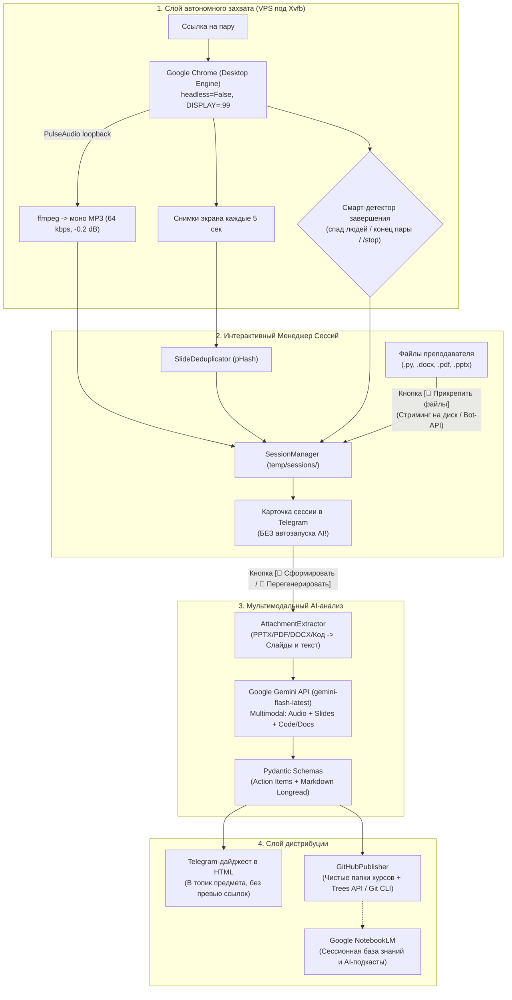

# 🎓 StudentAssistant

> **Автономный мультимодальный AI-ассистент для студентов-программистов.**  
> Автоматически подключается к онлайн-парам в **МТС-Линк** и **Яндекс-Телемост**, пишет чистый звук и сохраняет ключевые слайды, позволяет прикреплять файлы преподавателя (код, методички, презентации), формирует структурированные конспекты с кодом и выгружает экспресс-дайджест с ДЗ и дедлайнами в **Telegram-канал группы** и **GitHub**.

---

## 📌 Содержание
- [1. Проблема и решение](#1-проблема-и-решение)
- [2. Архитектура пайплайна](#2-архитектура-пайплайна)
- [3. Как это работает на слабом VPS (2 vCPU / 4 GB RAM)](#3-как-это-работает-на-слабом-vps-2-vcpu--4-gb-ram)
- [4. Структура проекта](#4-структура-проекта)
- [5. Управление сессиями и обогащение материалами](#5-управление-сессиями-и-обогащение-материалами)
- [6. Двухуровневая система артефактов и атрибуция модели](#6-двухуровневая-система-артефактов-и-атрибуция-модели)
- [7. Инструкция по быстрому старту](#7-инструкция-по-быстрому-старту)
  - [Повседневное использование в Telegram](#повседневное-использование-в-telegram)
  - [Прямой запуск из терминала](#прямой-запуск-из-терминала)
  - [Развертывание и обновление на Ubuntu VPS](#развертывание-и-обновление-на-ubuntu-vps)
- [8. Переменные окружения (.env)](#8-переменные-окружения-env)
- [9. Тестирование](#9-тестирование)
- [10. Дорожная карта и идеи развития (IDEAS.md)](#10-дорожная-карта-и-идеи-развития-ideasmd)
- [11. Стратегический уровень: Google NotebookLM к сессии](#11-стратегический-уровень-google-notebooklm-к-сессии)

---

## 1. Проблема и решение

| Типичная боль студента | Как решает StudentAssistant |
| :--- | :--- |
| **Невозможно всегда присутствовать онлайн** (работа, транспорт, наложение дел). | **Автономный бот-слушатель** сам заходит в конференцию под твоим именем, без включения камеры и микрофона. |
| **Преподаватели льют до 70% «воды»** (заминки, истории из жизни, повторы тривиального). | **Формула «Умный гибрид»**: нейросеть вырезает бытовой шум и оговорки, перестраивая лекцию в стройную статью/учебник уровня Habr с сохранением авторских терминов. |
| **Препод кидает код и методички отдельно после пары**. | **Обогащение сессий**: прямо в Telegram можно прикрепить файлы (`.py`, `.sh`, `.cpp`, `.docx`, `.pdf`, `.pptx`), и они войдут в контекст конспекта. |
| **Страх упустить требования к лабам и зачету**. | Модель натренирована вылавливать экзаменационные триггеры лектора, формулировки ДЗ и дедлайны в отдельный блок (с цитатами-доказательствами). |
| **Сложность разбора кода со смазанных видео**. | **pHash дедупликатор** выдергивает только уникальные кристально четкие скриншоты экрана (слайды, IDE, терминал) и встраивает их в Markdown. |

---

## 2. Архитектура пайплайна



---

## 3. Как это работает на слабом VPS (2 vCPU / 4 GB RAM)

Стандартные инструменты видеозаписи кодируют видео в 30 FPS, что гарантированно загружает 2 vCPU в 100% и приводит к зависанию сервера. Проект решает эту проблему за счет комплекса архитектурных оптимизаций и умных алгоритмов:

1. **Отказ от тяжелого видеокодирования**: видеопоток не пережимается через кодеки h264/h265.
2. **Аудио-лупбек PulseAudio под виртуальным Xvfb**: Chrome запускается с `DISPLAY=:99`, а системный звук через `VirtualSink.monitor` пишется в легковесный моно MP3 (16 kHz, 64 kbps). Нагрузка на CPU — **всего 2–3%**, а размер файла за 1,5 часа составляет **всего 40–60 МБ**.
3. **Перцептивное хеширование слайдов (pHash)**: бот делает снимки экрана по таймеру, но модуль `recorder/visual.py` сравнивает хеши соседних кадров. Если слайд не изменился (схожесть $\ge 95\%$), кадр отбрасывается. Из ~1000 скриншотов сохраняются только **15–30 уникальных слайдов**.
4. **Бесплатный `gemini-flash-latest` (Free Tier) с каскадным переключением**: обработка 1,5-часового аудио, слайдов и методичек происходит на серверах Google за 1–2 минуты и **стоит 0 рублей** в рамках бесплатного лимита Google AI Studio (15 RPM / 1500 RPD). Входное контекстное окно (1 млн токенов) и расширенное выходное окно (до 65 536 токенов) позволяют формировать исчерпывающие иллюстрированные конспекты со всеми блоками кода и формулами без искусственного урезания теории. При пиковой нагрузке серверов Google бот автоматически опрашивает каскад моделей в строгом приоритете: `gemini-flash-latest` ➔ `gemini-3.8-flash` ➔ `gemini-3.7-flash` ➔ `gemini-3.6-flash`.
5. **Защита от пиковых перегрузок (503 / High Demand)**: 16-ступенчатый каскад ($4 \times 4$ попытки) с терпеливыми паузами (20с, 40с, 60с) на каждую модель и неблокирующим вызовом через `asyncio.to_thread`. Позволяет пережить любые временные спайки нагрузки серверов Google без зависания Telegram-бота и потери соединения.
6. **Параллельная загрузка слайдов и относительные таймкоды (`MM:SS`)**: загрузка скриншотов в Google Files API ускорена в 5–10 раз благодаря пулу потоков (`ThreadPoolExecutor`) с экспоненциальным backoff при 429. Из временных меток в именах файлов вычисляются точные относительные таймкоды от старта пары, что дает безупречную синхронизацию слайдов со звуком.
7. **Автоматическая двусторонняя срезка тишины, dHash-дедупликация и гарантированный бэкап оригиналов (`slides_raw/`)**: за один проход `ffmpeg silencedetect` срезается тишина ожидания в начале пары (до прихода лектора) и тишина в конце, удаляются пред-лекционные кадры лобби, сдвигаются таймкоды слайдов, а анимации PowerPoint и промежуточные изменения экрана надежно схлопываются к финальной версии слайда. Перед любой модификацией или удалением кадров ядро дедупликатора (`SlideDeduplicator.postprocess()`) автоматически создает резервную копию всех исходных скриншотов в папку `slides_raw/` с фиксацией времени и количества в `.backup_meta.json`. Это гарантирует доступность кнопки `[ ↩️ Откатить слайды из бэкапа ]` в Telegram сразу после завершения пары (как в автоматическом лайв-пайплайне, так и при ручной отложенной постобработке через `SessionManager.create_slides_backup()`). Бэкапы хранятся 7 дней и очищаются автоматически. Таймкоды вычисляются динамически из временных меток скриншотов (`YYYY-MM-DD_HH-MM-SS`), точно синхронизированных по локальному времени (UTC+3 МСК).
8. **Мгновенный Fast Freeze при перезагрузках VPS (< 1.5 сек)**: при `systemd restart` или `SIGTERM`/`SIGINT` запись моментально замораживается без повреждения аудио и зомби-процессов, а постобработка откладывается до запуска по кнопке в карточке Telegram.
9. **Устойчивый WebRTC-клиент для МТС-Линк и Яндекс Телемоста (360 / Мессенджер)**: Chromium оптимизирован для работы на слабых зарубежных VPS (`--disable-quic`, `--disable-features=PostQuantumKyber,PostQuantumMLKEM`) с 3-этапным перезапуском навигации.
    - **Изоляция медиа-устройств и WebRTC Hardening**: контекст браузера создается строго с `permissions=["microphone"]` с полным исключением камеры. Через `add_init_script` в каждую страницу внедряется перехват WebRTC API: `navigator.mediaDevices.enumerateDevices` скрывает все `videoinput` (сайт видит ПК как систему без веб-камеры), а `navigator.mediaDevices.getUserMedia` принудительно сбрасывает видеотреки (`stop()`) и стартует аудио в заглушенном состоянии (`enabled = false`), гарантируя 100% защиту от утечки тестовой сетки Chromium в эфир.
    - **Обход прозрачных оверлеев через нативный DOM `.click()`**: Телемост монтирует прозрачные онбординг-слои (`.Orb-Overlay2`), перехватывающие синтетические события указателя Playwright. Прямой вызов JavaScript DOM `.click()` на элементах отключения микрофона, камеры и кнопке «Подключиться» гарантированно пробивает оверлеи без ошибок блокировки интерфейса.
    - **Строгая верификация входа в комнату**: проверка кнопок управления звонком (`[data-test-id*="hangup"]`, `button[class*="hangup"]`, `[aria-label*="Завершить"]`, `[aria-label*="Выйти"]`, `[aria-label*="Положить трубку"]`) выполняется строго внутри активного фрейма конференции, исключая ложные рапорты о входе (устранён ложный детект родительского виджета `.yamb-call-widget__end-button` до реального подключения).
    - **Комната ожидания**: корректное распознавание статусов ожидания (*«Вы в комнате ожидания...»*, *«Организатор видит ваш запрос...»*) с терпеливым ожиданием одобрения организатором.
    - **МТС-Линк (Бесшумный вход и защита от утечки устройств)**: поддержка прямых ссылок и форм обязательной регистрации (автоматическая транслитерация в латинский email, авто-скрытие боковой панели `aside.stream-sidebar`). На экране проверки устройств бот целенаправленно ищет и нажимает кнопку **«ПРИСОЕДИНИТЬСЯ БЕЗ УСТРОЙСТВ»** (вместо входа с устройствами), автоматически закрывает всплывающие модальные предупреждения (*«ПРИСОЕДИНИТЬСЯ БЕЗ КАМЕРЫ»* / `join-without-camera`), а в самой комнате выполняет контрольный проход `_mute_mts_in_room_devices()` по тулбару для проверки статуса микрофона и камеры.
    - **Чистые полноэкранные скриншоты 1920×1080**: скрытие бокового сайдбара Яндекс Мессенджера (`.yamb-sidebar`), надежное сворачивание боковой панели участников (`ensure_participants_panel_closed()` с фильтрацией кнопок тулбара) и автоматическое закрытие промо-модалок (*«Можно включить ИИ-конспект звонка»* через кнопку «Отлично» и крестик) и баннеров cookies.
10. **Идемпотентная перегенерация конспектов и защита оглавления от дублирования**: если к лекции позже появились уточняющие методички, презентации или код, их можно прикрепить прямо в карточке сессии Telegram и нажать `[🔄 Перегенерировать конспект]`. Бот обойдет локальный кэш анализа (`force_reanalyze=True`), обогатит мультимодальный контекст, обновит бандл лекции на GitHub и аккуратно заменит строку в оглавлениях (`Subject/README.md` и корневой `README.md`), гарантируя отсутствие дублей.
11. **Smart Exit 2.0 и Модуль старосты (Журнал посещаемости)**:
    - **Smart Exit 2.0 (4 универсальных правила завершения пары)**:
      1. *Хард-лимит или следующая пара*: если длительность встречи $\ge 180$ минут (3 часа, защита VPS от переполнения диска) ИЛИ до начала следующей пары по расписанию осталось 3–5 минут $\to$ **СТОП**, пара завершена.
      2. *Официальное закрытие комнаты*: если платформа вывела модальное окно завершения или произошёл редирект со страницы звонка $\to$ **СТОП**, пара завершена.
      3. *Тройное условие завершения*: если пара идёт $> 95.3$ мин **И** число участников $\le 3$ **И** фиксируется тишина в аудиопотоке на протяжении 3 минут $\to$ **СТОП**, пара завершена.
      4. *Все остальные случаи*: $\to$ **ПАРА ПРОДОЛЖАЕТСЯ**. Молчаливые лабы и затянувшиеся пары пишутся до реального ухода преподавателя.
    - **Модуль старосты (Журнал посещаемости)**:
      - Периодический опрос DOM списка участников каждые 30–60 секунд с фиксацией интервалов подключения `intervals: [[t_in, t_out], ...]`.
      - **100% невидимость при сборе**: во время чтения списка инжектируется временный CSS-стиль (`opacity: 0; right: -9999px`), выводящий панель за пределы экрана без прерывания рендеринга React, с мгновенным закрытием сразу после чтения.
      - **Карточка посещаемости в боте**: кнопка `[ 👥 Участники (N) ]` открывает алфавитный список студентов с точным временем на паре в минутах, процентом присутствия и интервалами входов/выходов, а также моноширинный блок (` ```text `) для копирования списка старостой в один клик.
      - Автоматическая фильтрация имени самого бота через `joined_name`.
12. **Безопасная HTML-разметка дайджеста и экранирование сущностей Telegram**:
    - Полный отказ от нестабильного Telegram Markdown в пользу строгого Telegram HTML (`<b>`, `<code>`, `<a href="...">`, `<blockquote>`) со сквозным экранированием через `html.escape()`.
    - Имена переменных, знаки умножения (`w_1 * x_1`), подчёркивания `_` и ссылки с кириллицей больше никогда не приводят к ошибкам парсера Telegram (`Bad Request: can't parse entities: byte offset...`).
    - Двухуровневая защита доставки: при любых непредвиденных отказах парсинга на стороне Telegram бот автоматически отправляет сообщение чистым текстом без тегов, гарантируя 100% доставку дайджеста.
13. **Нативная поддержка супергрупп и топиков форума (Topics / Threads)**:
    - Прямая отправка в топик курса: бот считывает привязанный к предмету `telegram_thread_id` и публикует дайджест сразу в целевую тему супергруппы (`message_thread_id=thread_id`), исключая путаницу между разными дисциплинами.
    - Отключение баннеров предпросмотра (`LinkPreviewOptions(is_disabled=True)`): карточка ссылки GitHub больше не занимает экран, дайджест получается компактным и легко читается с мобильных устройств.
    - Прозрачная диагностика прав: если у бота отсутствуют права на публикацию в топике или он не добавлен в супергруппу, администратор мгновенно получает точный текст ошибки в личные сообщения.
14. **Интеллектуальный экстрактор материалов и маршрутизация иллюстраций**:
    - Модуль `ai/attachment_extractor.py` автоматически распаковывает презентации (`.pptx`), извлекая ключевые слайды, таблицы и заметки спикера.
    - Тексты и схемы из файлов лектора объединяются с кадрами экрана и аудиозаписью в единый мультимодальный контекст.
    - Слайды и графические вложения автоматически связываются с текстом конспекта и оформляются в кликабельные иллюстрации в Markdown.
15. **Официальная структура репозитория конспектов и гибридный Git-движок**:
    - **Строгая структура каталогов**: папка предмета всегда называется в соответствии с официальным именем дисциплины из бота (например, `Data_Science`, `Сети`), предотвращая дублирование курсов.
    - **Полнотекстовые названия лекций**: директория лекции именуется по реальной дате проведения занятия (`YYYY-MM-DD_<Название>`), а улучшенный алгоритм `slugify` сохраняет границы целых слов до 100 символов (без обрезок вида `..._в_PyT`).
    - **Гибридный Git-движок (Trees API + Git CLI fallback)**: атомарная публикация конспектов через GitHub Trees API с автоматическим резервным переключением на локальный Git CLI при сбоях сети или ограничений токена.
16. **Потоковая загрузка файлов на диск и интеграция с Local Bot API**:
    - Файлы лекторов и аудиозаписи скачиваются напрямую на диск через потоковую запись (`destination=target_path`), что защищает слабый VPS (2 vCPU / 4 GB RAM) от переполнения оперативной памяти.
    - Поддержка собственного локального сервера Telegram Bot API (`TELEGRAM_API_SERVER` и `TELEGRAM_API_LOCAL_ROOT`) снимает стандартный лимит Telegram в 20 МБ и позволяет загружать файлы вплоть до 2 ГБ.
17. **Строгий режим тишины в группах и топиках (Outbound-only policy)**:
    - Бот полностью игнорирует любые входящие сообщения, документы и команды в групповых чатах, супергруппах и топиках тем (`chat.type != "private"` в `AuthMiddleware`).
    - Бот не оставляет лишних сообщений-заглушек в темах — всё взаимодействие со студентом происходит строго в личных сообщениях, а в топик курса бот отправляет исключительно итоговый дайджест.
18. **Неблокирующая фоновая постобработка и динамический трекер статуса**:
    - Тяжелые операции срезки тишины в ffmpeg, анализа уровней звука и дедупликации сотен слайдов через dHash выполняются асинхронно в пуле потоков через `asyncio.to_thread`, сохраняя Telegram-бот на 100% отзывчивым.
    - В Главном меню (`/start`) отображается живой трекер состояния бота (`Свободен` с указанием следующей пары по расписанию, `Идёт запись`, `Постобработка`, `Нейроанализ Gemini`, `Публикация`) и контекстные кнопки управления (`[📸 Снимок экрана]`, `[⏹️ Завершить запись]`).
19. **Ролевая модель доступа и изолированный кабинет старосты (RBAC)**:
    - **Назначение старосты прямо из интерфейса бота**: владелец бота может назначить, изменить или отозвать Telegram ID старосты через меню `[ ⚙️ Настройки бота ] ➔ [ 👥 Управление старостой ]` без перезапуска сервиса и без редактирования `.env` (динамическая запись в `data/user_settings.json`).
    - **Изолированный интерфейс старосты**:
      - **Главное меню**: полноценная навигация, во время активной записи пары старосте доступна **только** кнопка `[ 📸 Снимок экрана ]` и полностью скрыта кнопка завершения записи `[ ⏹️ Завершить запись ]`.
      - **Каталог лекций (`/sessions` или кнопка `[ 🗂 Предметы и сессии ]`)**: староста может свободно просматривать каталог дисциплин и карточки прошедших пар, где ему доступны **только** просмотр материалов: `[ 🖼 Слайды (N) ]`, `[ 🎵 Аудио ]`, `[ 👥 Участники (N) ]` (журнал посещаемости пары), `[ 📖 Открыть конспект на GitHub ]` и кнопка `[ ⬅️ Назад ]`. Кнопки запуска генерации конспекта, постобработки, добавления файлов и удаления сессии скрыты.
      - **Расписание (`/schedule`)**: режим «Только чтение» — староста видит текущее расписание и ссылки занятий, с кнопками `[ 🔄 Обновить расписание ]` и `[ ⬅️ В главное меню ]` без кнопок добавления/удаления пар.
      - **Настройки (`/settings`)**: информационное уведомление о том, что управление настройками доступно только владельцу бота.
    - **Строгая серверная защита (Backend RBAC Guard)**:
      - Любые прямые callback-запросы к мутирующим операциям (`sess_run_ai`, `sess_postproc`, `sess_restore_slides`, `sess_del_*`, `sess_add_files*`, `sched_*`, смене имени, остановке записи `/stop` или `btn_stop`) блокируются на бэкенде через `ensure_owner` со всплывающим алертом: `⚠️ Это действие доступно только владельцу бота.`
      - Отправка ссылок на звонки (`telemost.yandex.ru`, `mts-link.ru`) и загрузка файлов в чат от старосты блокируются информационными сообщениями.
20. **Защита от ложного срыва записи и Health-Check аудиопотока**:
    - **Двухфакторный гистерезис детектора закрытия**: в `recorder/browser.py` и `recorder/monitor.py` обработка ошибок Playwright CDP возвращает `False` при микро-лагах DOM, а завершение пары по правилу платформы требует 2 последовательных подтверждения (`ended_checks_threshold=2`).
    - **Постоянный мониторинг ffmpeg**: каждые 30 секунд в цикле мониторинга выполняется проверка живости процесса записи звука (`is_alive`), предотвращая «слепую» запись при внезапных системных сбоях.
21. **Безопасная in-memory аутентификация Git CLI и санитизация секретов**:
    - Токен доступа GitHub никогда не сохраняется в открытом виде на диске в `.git/config` — аутентификация передается строго в оперативной памяти на время выполнения команды через HTTP-заголовок (`-c http.extraheader="AUTHORIZATION: basic <base64>"`).
    - Функция `mask_credentials` гарантированно скрывает токены и учетные данные из URL, вывода `stderr`, трассировок исключений и журналов `systemd`.
22. **Автоматический жизненный цикл сессий и контроль дискового пространства**:
    - **Фоновый сборщик устаревших бэкапов**: папки `slides_raw/` старше 7 дней удаляются автоматически (`cleanup_expired_backups`) при создании сессий, запуске бота и в ежедневном цикле фонового планировщика.
    - **Safe-Check диска перед записью**: перед созданием сессии бот проверяет свободное место (`shutil.disk_usage`). Если свободно < 1.5 ГБ, бот отправляет информационный алерт в Telegram, **не прерывая запись пары** и сохраняя исходные аудиофайлы для возможного переанализа.


---

## 4. Структура проекта

```
StudentAssistant/
├── config.py                   # Конфигурация (Pydantic Settings + .env)
├── requirements.txt            # Зависимости (aiogram, google-genai, playwright, pillow, python-docx)
├── .env.example                # Шаблон настроек и токенов
├── orchestrator.py             # LectureOrchestrator: координатор конвейера обработки
├── run_poc.py                  # CLI утилита для тестирования ядра на локальных файлах
├── run_capture.py              # CLI утилита для захвата звонка по ссылке
├── IDEAS.md                    # Точки роста, дорожная карта развития и стратегические идеи
│
├── recorder/                   # МОДУЛЬ ЗАХВАТА ЗВОНКОВ И СЕССИЙ
│   ├── browser.py              # Playwright-клиент: Xvfb, стелс-вход в МТС-Линк и Телемост, DOM-парсинг участников
│   ├── audio.py                # AudioRecorder: запись звука через PulseAudio, авто-обрезка тишины
│   ├── visual.py               # SlideDeduplicator: pHash захват + dHash постобработка дубликатов
│   ├── monitor.py              # MeetingMonitor: Smart Exit 2.0, контроль завершения звонка и трекинг присутствия
│   ├── attendance.py           # ParticipantTracker: интервальный трекинг посещаемости, debounce (90с) перезаходов
│   ├── schedule_manager.py     # ScheduleManager: хранилище и парсинг расписания пар группы
│   └── session_manager.py      # SessionManager: хранилище сессий, метаданных (attendance) и вложений
│
├── ai/                         # AI-ЯДРО (Google Gemini Flash)
│   ├── schemas.py              # Pydantic-модели (ActionItem, ActionItemsDigest с HTML-рендерингом, IllustratedLongread)
│   ├── prompts.py              # Системные промпты «Умного гибрида» и учет материалов лектора
│   ├── analyzer.py             # Мультимодальный клиент с поддержкой вложений (.py, .docx, .pdf)
│   └── attachment_extractor.py # Интеллектуальный парсер вложений (.pptx, .pdf, .docx, картинок, кода)
│
├── publisher/                  # МОДУЛЬ ДИСТРИБУЦИИ
│   ├── github_sync.py          # GitHubPublisher: коммит конспектов (Trees API + Git CLI fallback), единые папки предметов
│   └── telegram_pub.py         # TelegramPublisher: HTML-дайджест, отправка в топики супергрупп по ID, отключение превью ссылок
│
├── bot/                        # TELEGRAM-БОТ УПРАВЛЕНИЯ (aiogram 3)
│   ├── main.py                 # Точка входа Long Polling бота, обработка сигналов и восстановление сессий
│   ├── handlers.py             # Обработчики команд, расписания, карточек сессий, стриминга вложений на диск и ссылок
│   ├── keyboards.py            # Инлайн-клавиатуры меню, расписания, сессий и пагинации
│   ├── middlewares.py          # AuthMiddleware: строгая фильтрация доступа по ID владельца и режим тишины в группах
│   ├── scheduler.py            # ScheduleAutoJoinService: автономный фоновый вход по расписанию
│   ├── state_tracker.py        # BotStateTracker: живой статус бота (IDLE, RECORDING, POSTPROCESSING, ANALYZING)
│   └── shutdown_manager.py     # GracefulShutdownManager: Fast Freeze (<1.5с) при перезагрузках VPS
│
├── scripts/
│   ├── setup_vps.sh            # Автоматическая настройка Ubuntu Server (Xvfb, PulseAudio, Chrome)
│   ├── test_vps_audio.py       # Скрипт сквозной диагностики захвата звука
│   ├── compare_slides.py       # CLI-утилита для попарного сравнения слайдов по pHash/dHash
│   └── test_postprocess_session.py # Диагностика, срезка тишины и dHash-очистка тестовых сессий
│
└── tests/                      # НАБОР АВТОТЕСТОВ (177 тестов, pytest)
    ├── test_headman_rbac.py    # Тестирование ролевой модели старосты (RBAC): права, UI-кабинет, клавиатуры, backend protection
    ├── test_attachment_extractor.py # Тестирование извлечения слайдов/таблиц из PPTX/PDF/DOCX и Markdown-иллюстраций
    ├── test_telegram_topics.py # Тестирование топиков форума, привязки ID веток и отправки дайджестов
    ├── test_audit_fixes.py     # Тестирование безопасности потоков, Git CLI fallback, экранирования HTML и Local Bot API
    ├── test_session_manager.py # Тестирование создания, листинга, метаданных, бэкапа slides_raw (create_slides_backup) и вложений сессий
    ├── test_keyboards.py       # Тестирование клавиатур карточек, посещаемости и кнопок во время записи
    ├── test_state_and_attendance.py # Тестирование статусов BotStateTracker, журнала старосты и форматирования
    ├── test_analyzer_attachments.py # Тестирование промпта и вложений в анализатор
    ├── test_analyzer.py        # Тестирование моделей Gemini и атрибуции модели
    ├── test_analyzer_enhancements.py # Тестирование таймкодов, санитизации ссылок и параллельной загрузки
    ├── test_visual.py          # Тестирование pHash/dHash дедупликации, авто-бэкапа slides_raw до постобработки, срезки тишины и пред-слайдов
    ├── test_audio_silence.py   # Тестирование двусторонней срезки тишины в начале и конце аудио
    ├── test_attendance.py      # Тестирование интервального трекинга посещаемости и debounce (90с)
    ├── test_shutdown.py        # Тестирование Fast Freeze, восстановления сессий и кнопки постобработки
    ├── test_schemas.py         # Тестирование Pydantic-схем, HTML-форматирования и рендеринга Markdown
    ├── test_github_sync.py     # Тестирование структуры Git, Trees API, Git CLI fallback и таблицы оглавления
    ├── test_orchestrator.py    # Интеграционный тест пайплайна (с поддержкой slide_paths)
    ├── test_monitor.py         # Тестирование Smart Exit 2.0 и интеграции трекинга посещаемости
    ├── test_browser_config.py  # Тестирование флагов Chromium, параметров звука и маркеров МТС/Телемост
    ├── test_auth_middleware.py # Тестирование тихой авторизации по ID владельца и игнорирования групп
    ├── test_schedule_manager.py # Тестирование CRUD расписания пар
    └── test_scheduler.py       # Тестирование окна входа и автозапуска по расписанию
```

---

## 5. Управление сессиями и обогащение материалами

После завершения пары или остановки по команде `/stop` бот **не запускает анализ автоматически**. Запись сохраняется в изолированную директорию сессии:

```text
temp/sessions/session_2026-09-10_13-43-52/
├── metadata.json       # Метаданные, длительность, уровень громкости, статус, вложения
├── audio.mp3           # Записанный аудиопоток пары (-0.2 dB)
├── slides/             # Уникальные слайды (slide_001.png, ...)
├── slides_raw/         # [Автобэкап] Исходные слайды до постобработки (хранятся 7 дней)
└── attachments/        # Файлы от преподавателя (solution.py, Lab1_Guide.docx, ...)
```

### Возможности в Telegram-боте:
- `/sessions` — интерактивный список всех сохраненных сессий с постраничной навигацией (`[◀️ Назад] [Стр 1/N] [Вперед ▶️]`).
- **Инспекция материалов**:
  - `[👥 Участники (N)]` — **Журнал старосты**: детальный список участников пары с расчетом чистого времени присутствия в минутах, процентом посещаемости и временными интервалами входов/выходов, а также готовый моноширинный блок для копирования в 1 клик для отправки в деканат/преподавателю.
  - `[🖼 Слайды (N)]` — просмотр альбома захваченных слайдов прямо в чате.
  - `[🎵 Аудио]` — прослушивание записанного `.mp3` файла для проверки громкости и качества речи.
- **Прикрепление и управление файлами материалов**:
  - Кнопка `[📎 Прикрепить файлы]` открывает специализированное меню управления вложениями.
  - **Просмотр и аналитика**: бот выводит интерактивный список всех загруженных файлов с точным указанием размера каждого в `KB`/`MB`.
  - **Поштучное удаление (`[🗑 Удалить файл...]`)**: быстрый выбор любого файла для мгновенного удаления в один клик с защитой от ограничений Telegram Callback Data (индексная адресация).
  - **Полная очистка (`[🧹 Очистить все]`)**: очистка вложений сессии с экраном подтверждения для предотвращения случайной потери данных.
  - **Широкий спектр поддерживаемых форматов**:
    - Исходный код и скрипты (`.py`, `.sh`, `.cpp`, `.sql`, `.java`, `.ts`).
    - Методички и документы (`.docx`, `.txt`, `.pdf`).
    - Презентации (`.pptx`) с автоматическим парсингом слайдов и нативных таблиц в чистый Markdown.
    - Обычные изображения и схемы (`.png`, `.jpg`, `.jpeg`, `.webp`): интеллектуальная фильтрация мусорных логотипов и иконок по геометрии и цветовой дисперсии.
  - **Строгая изоляция директорий (`slides/` vs `attachments/`)**:
    - Папка `slides/` содержит **только** скриншоты звонка (`slide_*.png`). Если слайд из презентации/вложений совпадает со скриншотом из звонка по pHash, четкий оригинал аккуратно заменяет мутный кадр звонка прямо на месте (`slide_*.png`).
    - Все внешние файлы, методички и схемы сохраняются строго в `attachments/` и никогда не перемешиваются со слайдами вебинара. В Markdown конспекта ссылки на кадры звонка ведут в `slides/`, а на прикрепленные схемы — в `attachments/`.
  - **Поддержка локального Bot API сервера**: zero-copy передача файлов с хоста без повторного скачивания по сети при настроенной переменной `TELEGRAM_API_LOCAL_ROOT`.
- **Локальное кэширование AI-анализа (`analysis_cache.json`)**:
  - Результат анализа Gemini сохраняется в локальный JSON-кэш сессии. Если на этапе публикации произошел сетевой сбой (например, дроп соединения со стороны GitHub), повторное нажатие кнопки «Сформировать конспект» мгновенно подтягивает готовый анализ из кэша, не тратя токены и время на повторный запрос к AI Studio.
  - При нажатии `[ 🔄 Перегенерировать конспект ]` кэш автоматически инвалидируется, выполняя свежий анализ.
- **Отказоустойчивая публикация на GitHub (Двойной контур)**:
  - **Основной контур**: атомарный `Git Trees API` (один коммит для конспекта, оглавлений и всех ассетов).
  - **Резервный контур**: автоматический фоллбек на консольный `Git CLI` (`git clone / pull / add / commit / push`), если REST API GitHub (`api.github.com`) блокируется ТСПУ/РКН или падает по таймауту TLS-рукопожатия.
  - **Асинхронность**: неблокирующее выполнение в фоновом потоке (`asyncio.to_thread`), гарантирующее, что Telegram-бот не зависнет при передаче тяжелых слайдов.
  - Поддержка проксирования через переменную `HTTPS_PROXY`.
- **Постобработка звука и слайдов прямо в карточке**:
  - Кнопка `[ ⚙️ Запустить постобработку ]` / `[ ⚙️ Перезапустить постобработку ]` позволяет в любой момент обрезать тишину в начале/конце аудио, удалить кадры лобби и схлопнуть дубликаты слайдов.
  - **Безопасный 7-дневный бэкап и откат**: перед модификацией слайдов ядро автоматически архивирует все исходные кадры в папку `slides_raw/` с файлом `.backup_meta.json` (как при авто-постобработке сразу после звонка, так и при ручном запуске). Если при дедупликации случайно отсекся нужный кадр, в карточке Telegram сразу доступна кнопка `[ ↩️ Откатить слайды из бэкапа ]`, возвращающая все исходные слайды в один клик. Бэкапы старше 7 дней автоматически удаляются для экономии диска.
  - Если запись была прервана перезагрузкой сервера, бот заморозит её со статусом `⏸️` и выведет кнопку быстрого запуска постобработки.
- **Контролируемый запуск и перегенерация AI**:
  - Кнопка `[ 🚀 Сформировать конспект ]` запускает анализ только тогда, когда все материалы собраны и проверены (если постобработка еще не выполнялась, бот выполнит её автоматически перед отправкой в Gemini)!
  - Если конспект уже сформирован, кнопка на карточке наглядно превращается в `[ 🔄 Перегенерировать конспект ]`. При добавлении новых файлов лектора (`[📎 Файлы]`), смене темы или предмета вы можете запустить перегенерацию в один клик: бот обойдет локальный кэш анализа, сформирует обновленный лонгрид с учетом добавленных материалов и обновит файлы на GitHub без дублирования строк в оглавлении.

---

## 6. Двухуровневая система артефактов и атрибуция модели

Каждая обработанная лекция порождает два формата с обязательным указанием сгенерировавшей её модели:

### Уровень 1: Telegram Action Items (для топика группы / канала)
*Публикуется в Telegram HTML напрямую в ветку предмета (`telegram_thread_id`). Чтение за 1 минуту, баннер ссылки скрыт.*
```html
⚡ <b>Архитектура ПО | Паттерны проектирования: Dependency Injection</b>

📌 <b>Главное в двух словах:</b>
Разобрали разницу между IoC и DI, частые ошибки внедрения зависимостей и жизненные циклы.

🎯 <b>Action Items (ДЗ, дедлайны и требования):</b>
🔴 [Лабораторная] <b>Лабораторная работа №3: Реализация DI-контейнера</b> (Срок: До пятницы, 23:59)
   <i>Свой контейнер с поддержкой Singleton и Transient. Сдавать строго в Git-репозиторий.</i>
   <blockquote>Источник: «Сдаем строго через pull request в репозиторий группы до конца следующей недели»</blockquote>
🟠 [Экзамен/Зачет] <b>Вопрос к зачету: Lifecycle зависимостей</b>
   <i>Преподаватель подчеркнул: обязательно спросит разницу между Scoped и Transient.</i>
   <blockquote>Источник: «Этот вопрос будет у каждого второго в билетах»</blockquote>

🔍 <b>Что погуглить / стек:</b> <code>Inversion of Control</code>, <code>Dependency Injection</code>, <code>Service Locator</code>

🧠 <b>AI-модель:</b> gemini-flash-latest

📖 <a href="https://github.com/username/repo/blob/main/Subject/Date_Topic/Date_Topic.md">Читать полный конспект с иллюстрациями</a>
```

### Уровень 2: Иллюстрированный Markdown-лонгрид (в GitHub)
*Складывается в репозиторий предмета: `Предмет/Дата_Тема.md`.*
- В шапке документа фиксируется точная модель:
  ```markdown
  > 📅 **Дата:** 10.09.2026 | 🎓 **Дисциплина:** Архитектура ПО | 🧠 **AI-Модель:** gemini-flash-latest
  ```
- Полная вычищенная теория с исправленными речевыми ошибками лектора.
- Чистые блоки кода и разбор прикрепленных скриптов преподавателя.
- Автоматически встроенные скриншоты слайдов (``).
- Блоки предупреждений к сессии (`> [!IMPORTANT] На заметку к зачету`).
- Автоматическое обновление сводного оглавления в корневом `README.md` курса.

---

## 7. Инструкция по быстрому старту

### Повседневное использование в Telegram

1. **Команды бота**:
   - `/start` — главное меню и навигация: статус бота, кнопки `[ 🗂 Предметы и сессии ]`, `[ 📅 Расписание ]`, `[ ⚙️ Настройки бота ]`.
   - `/settings` — меню настроек (отображение и смена имени студента, часовой пояс, AI-модель, назначение и отзыв Telegram ID старосты группы).
   - `/name [Имя]` — быстро изменить или задать имя участника для входа в звонки (сохраняется между перезапусками).
   - `/schedule` — интерактивное расписание пар группы, привязка ссылок и предметов для авто-входа.
   - `/sessions` — каталог лекций по предметам (кнопка `[ 🗂 Предметы и сессии ]`) и управление сохранёнными сессиями.
   - `/status` — статус сервера, текущее имя студента при входе, активная AI-модель и состояние записей.
   - `/screenshot` — мгновенный снимок экрана активной встречи.
   - `/stop` — завершить запись текущей пары и сохранить в сессию.
   - `/models` — список моделей, доступных по вашему Google API ключу.
   - `/myid` — узнать свой Telegram ID (для настройки доступа владельца или назначения старосты).
2. **Настройка имени и навигация**:
   - **Имя студента при входе**: по умолчанию бот подключается как `Студент`. Через команду `/name Иван Иванов` или меню `/settings` можно задать любое имя. Оно сохраняется на сервере в `data/user_settings.json` и автоматически используется во всех платформах (Яндекс.Телемост, МТС Линк и др.).
   - **Универсальная синяя кнопка «⬅️ Назад»**: во всех разделах, экранах и диалогах бота в самом низу клавиатуры размещена нативная синяя кнопка (Telegram `style="primary"`), позволяющая всегда вернуться на предыдущий шаг без потери контекста.
3. **Запись пары**:
   - Отправьте боту ссылку на встречу в **МТС-Линк** (`https://link.mts.ru/...`) или **Яндекс-Телемост** (`https://telemost.yandex.ru/j/...`).
   - Бот подтвердит вход под вашим именем и пришлет кнопки управления (`[📸 Снимок экрана]`, `[⏹️ Завершить запись]`).
4. **Формирование и перегенерация конспекта**:
   - После окончания пары бот пришлет карточку сессии.
   - Нажмите `[📎 Файлы]` и перешлите боту методички или код, если лектор поделился ими.
   - Нажмите `[🚀 Сформировать конспект]`, и готовый результат будет отправлен в Telegram и на GitHub!
   - Если преподаватель позже скинул дополнительные файлы, просто добавьте их через `[📎 Файлы]` и нажмите появившуюся кнопку `[🔄 Перегенерировать конспект]` — бот перезапишет конспект с учетом новых материалов.

---

### Прямой запуск из терминала

1. **Запись живого звонка по ссылке**:
   ```bash
   python run_capture.py --url "ССЫЛКА_НА_МТС_ИЛИ_ТЕЛЕМОСТ" --subject "Архитектура ПО"
   ```
2. **Обработка готовой локальной записи (MP3/WAV)**:
   ```bash
   python run_poc.py --audio "путь/к/аудио.mp3" --subject "Базы данных"
   ```
3. **Синтетическое демо (Dry-run)**:
   ```bash
   python run_poc.py --demo
   ```

---

### Пакетное тестирование и постобработка сессий (CLI)

Утилита [`scripts/test_postprocess_session.py`](scripts/test_postprocess_session.py) позволяет проверить работу алгоритма обрезки тишины и dHash-дедупликации слайдов на сохранённых материалах сессий:

1. **Безопасный экспорт очищенных слайдов в отдельную папку**:
   Оригинальные скриншоты остаются нетронутыми, а в целевую папку копируются только уникальные финальные версии слайдов:
   ```bash
   python scripts/test_postprocess_session.py "C:\StudentAssistant\seti_1" --output-dir "C:\StudentAssistant\seti_1\slides_cleaned"
   ```

2. **Режим симуляции (Dry-run)**:
   Выводит в консоль подробный отчёт о найденном хвосте тишины и сгруппированных сериях дубликатов без изменения файлов:
   ```bash
   python scripts/test_postprocess_session.py "C:\StudentAssistant\seti_1" --dry-run
   ```

3. **Тестирование другого порога различий (`--bits`)**:
   По умолчанию используется безопасный порог `3` бита. Для более агрессивного сжатия шагов анимации можно указать `4`:
   ```bash
   python scripts/test_postprocess_session.py "C:\StudentAssistant\seti_1" --bits 4 --dry-run
   ```

4. **Попарное сравнение конкретных картинок**:
   Скрипт [`scripts/compare_slides.py`](scripts/compare_slides.py) вычисляет pHash и dHash, точное число несовпадающих бит и сходство:
   ```bash
   python scripts/compare_slides.py slide1.png slide2.png --bits 3
   ```

---

### Развертывание и обновление на Ubuntu VPS

1. **Первоначальная установка**:
   ```bash
   git clone https://github.com/Fiku5/StudentAssistant-dev.git ~/StudentAssistant
   cd ~/StudentAssistant
   chmod +x scripts/setup_vps.sh
   ./scripts/setup_vps.sh
   cp .env.example .env && nano .env
   systemctl enable --now student-assistant
   ```

2. **Обновление в 1 команду**:
   ```bash
   cd ~/StudentAssistant
   git pull && systemctl restart student-assistant
   ```

3. **Проверка логов и сервиса**:
   ```bash
   systemctl status student-assistant
   journalctl -u student-assistant -f --no-pager
   ```

---

## 8. Переменные окружения (.env)

| Переменная | Описание | Значение по умолчанию |
| :--- | :--- | :--- |
| `GEMINI_API_KEY` | API-ключ Google AI Studio ([получить бесплатно](https://aistudio.google.com/)) | `""` |
| `GEMINI_MODEL` | Модель для анализа (флагман Free Tier) | `gemini-flash-latest` |
| `TELEGRAM_BOT_TOKEN` | Токен управления ботом от [@BotFather](https://t.me/BotFather) | `""` |
| `TELEGRAM_CHANNEL_ID` | ID или `@username` канала группы для публикации | `""` |
| `TELEGRAM_GROUP_ID` | ID супергруппы с топиками для публикации в ветки предметов | Значение `TELEGRAM_CHANNEL_ID` |
| `ALLOWED_TELEGRAM_USERS` | Белый список Telegram ID пользователей/администраторов через запятую | `""` |
| `TELEGRAM_API_SERVER` | URL локального сервера Bot API для загрузки файлов до 2 ГБ | `None` |
| `TELEGRAM_API_LOCAL_ROOT` | Путь к директории хранения файлов локального Bot API | `None` |
| `GITHUB_REPO_URL` | URL репозитория курса для пуша конспектов | `""` |
| `GITHUB_TOKEN` | Personal Access Token для GitHub REST API | `""` |
| `GITHUB_BRANCH` | Целевая ветка репозитория конспектов | `main` |
| `HTTPS_PROXY` | HTTP/SOCKS5 прокси для обхода блокировок при обращении к GitHub API | `None` |
| `STUDENT_NAME` | Имя студента, под которым бот заходит на пары | `Студент` |
| `SLIDE_SIMILARITY_THRESHOLD` | Порог дедупликации слайдов pHash (0.0 – 1.0) | `0.95` |
| `SLIDE_CAPTURE_INTERVAL_SEC` | Интервал снятия скриншотов в секундах | `5` |
| `MAX_LECTURE_DURATION_MIN` | Максимальная длительность пары (таймаут) | `180` |
| `MIN_LECTURE_DURATION_MIN` | Время до включения детектора спада людей | `65` |
| `PARTICIPANT_DROP_THRESHOLD`| Критический порог оставшихся участников | `3` |
| `MIN_LEADING_SILENCE_SEC` | Порог отсечения тишины в начале записи (секунды) | `20.0` |
| `MIN_TRAILING_SILENCE_SEC`| Порог отсечения тишины в конце записи (секунды) | `25.0` |
| `SILENCE_THRESHOLD_DB`    | Порог чувствительности шума детектора тишины (dB) | `-38.0` |
| `SIMULATION_MODE`         | Режим симуляции без внешних API (`true`/`false`) | `false` |

---

## 9. Тестирование

Проект покрыт **177 автоматическими тестами** на базе `pytest`:
```bash
python -m pytest tests/ -v
```

### Тестовые наборы:
- `test_headman_rbac.py` — ролевая модель RBAC старосты: проверка прав `is_headman`/`is_owner`, динамическое назначение/отзыв старосты через интерфейс, изоляция кнопок в меню/карточках/расписании/настройках, пропуск в `AuthMiddleware` и строгая серверная защита всех мутирующих эндпоинтов от несанкционированных вызовов.
- `test_state_and_attendance.py` — динамический трекер статусов постобработки в Главном меню и карточке сессии, интерактивный журнал посещаемости старосты с моноширинным блоком для копирования.
- `test_attachment_extractor.py` — интеллектуальный парсинг PPTX/PDF/DOCX, контекстный менеджер PyMuPDF (`with fitz.open`), освобождение файловых дескрипторов без `WinError 32`, извлечение слайдов и таблиц, дополнение мультимодального промпта и связывание иллюстраций с Markdown.
- `test_telegram_topics.py` — валидация ссылок на топики форума, сохранение `telegram_thread_id` по предметам, отправка дайджестов в нужные ветки супергруппы и обработка ошибок доступа.
- `test_audit_fixes.py` — аудит надежности: отказоустойчивый fallback на Git CLI при сбоях Trees API, экранирование HTML-тегов, потоковое скачивание файлов без перегрузки RAM, атомарное сохранение JSON и интеграция с Local Bot API.
- `test_attendance.py` — интервальный трекинг посещаемости, сглаживание переподключений (debounce 90 сек), защита от накрутки (кратковременные входы), расчет чистого времени и сериализация в `metadata.json`.
- `test_audio_silence.py` — двусторонняя детекция и срезка начальной и хвостовой тишины в аудио через ffmpeg за 1 проход, неблокирующий пульс-замер недавней громкости (`check_recent_audio_level`), контроль живости аудиопроцесса.
- `test_shutdown.py` — мгновенный Fast Freeze (<1.5с) при SIGTERM/SIGINT, авто-восстановление сессий на старте, обработчики кнопок постобработки и отката слайдов из бэкапа.
- `test_analyzer_enhancements.py` — относительные таймкоды слайдов (MM:SS), санитизация ссылок на слайды, повторы при 429 и обход дедупликации в оркестраторе.
- `test_session_manager.py` — хранилище сессий, метаданные, блок `attendance`, 7-дневный автобэкап оригиналов слайдов (`slides_raw/`, `create_slides_backup`), фоновый сборщик устаревших бэкапов `cleanup_expired_backups`, мониторинг свободного места (`get_disk_space_info`, `get_free_disk_space_gb`), восстановление из бэкапа, динамический расчет таймкодов, папки вложений и удаление.
- `test_keyboards.py` — инлайн-клавиатуры карточек сессий, динамическое Главное меню, кнопка журнала старосты с числом студентов, кнопки постобработки и отката слайдов из бэкапа, постраничная навигация и универсальная синяя кнопка «Назад».
- `test_analyzer_attachments.py` — интеграция кода и документов в промпт Gemini.
- `test_analyzer.py` — валидация вызовов моделей Gemini, строгий каскадный приоритет моделей (`gemini-flash-latest` впереди `3.8-flash`) и атрибуция модели.
- `test_visual.py` — перцептивное хеширование (pHash/dHash), автоматическое создание бэкапа `slides_raw/` до постобработки, очистка пред-слайдов лобби, сдвиг таймкодов и сброс дубликатов к последнему кадру.
- `test_schemas.py` — Pydantic-модели, HTML-рендеринг дайджестов и Markdown-сериализация.
- `test_github_sync.py` — структура Git-директорий, синхронизация коммитов (Trees API + Git CLI), безопасная in-memory авторизация через `http.extraheader`, санитизация секретов в `mask_credentials`, замена строк оглавления без дублей и защита от 409 Conflict.
- `test_orchestrator.py` — интеграционный конвейер оркестратора, кэширование AI-анализа и принудительная перегенерация (`force_reanalyze`).
- `test_monitor.py` — Smart Exit 2.0: 4 универсальных правила завершения пары, защита от ложного срыва `is_meeting_ended` (2-факторный гистерезис и проверки `is_closed`), Health-Check процесса аудио (`ffmpeg is_alive` каждые 30 секунд), сбор посещаемости в `exit_info` и неблокирующая фоновая постобработка (`asyncio.to_thread`).
- `test_browser_config.py` — флаги Chromium, Xvfb, PulseAudio loopback, регистрация в вебинарах МТС-Линк и Телемост 360, обход онбординга и защита активных комнат.
- `test_auth_middleware.py` — фильтрация доступа по Telegram ID владельца бота и политика абсолютной тишины в группах/каналах (игнорирование чужих сообщений и служебных апдейтов).
- `test_schedule_manager.py` — парсинг и управление расписанием пар группы, проверка приближения следующей пары по расписанию (`is_next_pair_imminent`).
- `test_scheduler.py` — планировщик автономного входа на пары по расписанию.

---

## 10. Дорожная карта и идеи развития (IDEAS.md)

- 💡 [Точки роста и дорожная карта (IDEAS.md)](IDEAS.md) — стратегические инициативы (экзаменационный копайлот к сессии, единый PDF-учебник курса, Instant View в Telegraph), матрица приоритетов и архитектурные векторы развития для команды разработки.

---

## 11. Стратегический уровень: Google NotebookLM к сессии

Все сгенерированные конспекты и материалы семестра образуют идеальную базу знаний к экзаменам:
1. Загрузите Markdown-файлы и презентации преподавателя в блокнот предмета в [Google NotebookLM](https://notebooklm.google.com/).
2. Формируйте шпаргалки по билетам:
   > *«Составь ответы на экзаменационные вопросы, используя строго термины и примеры лектора из лекций №2, 5 и 8»*.
3. Создавайте глубокие аудио-подкасты (Deep Dive) по пройденным темам семестра для повторения перед зачетом.

---

## 📄 Лицензия
MIT License. Создано для студентов и академического сообщества.
